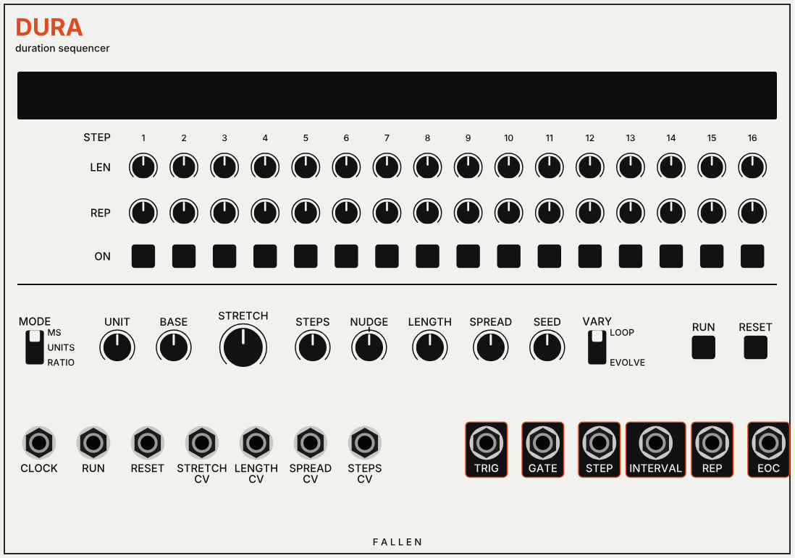
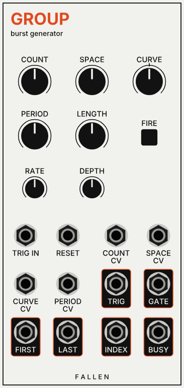
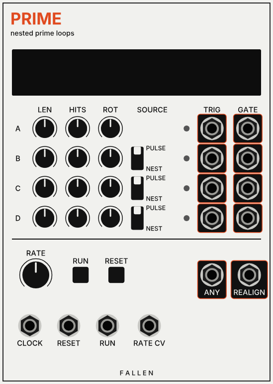
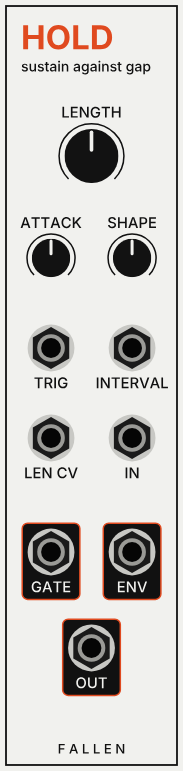
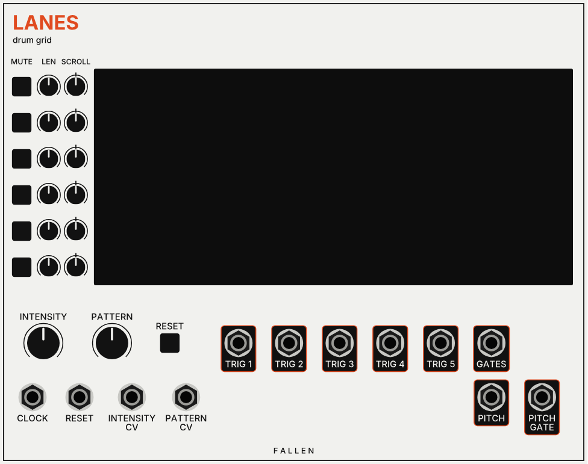
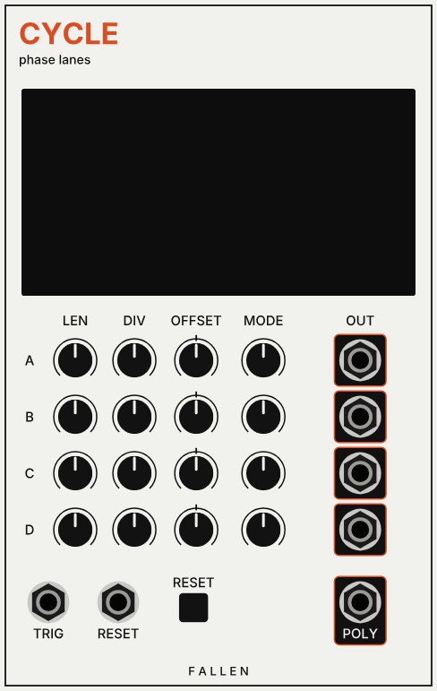
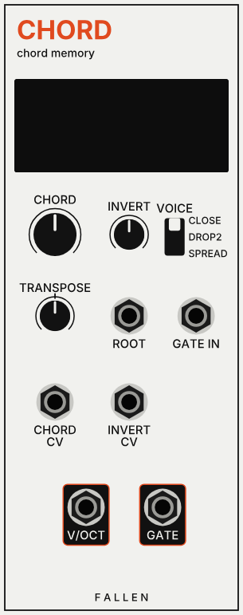
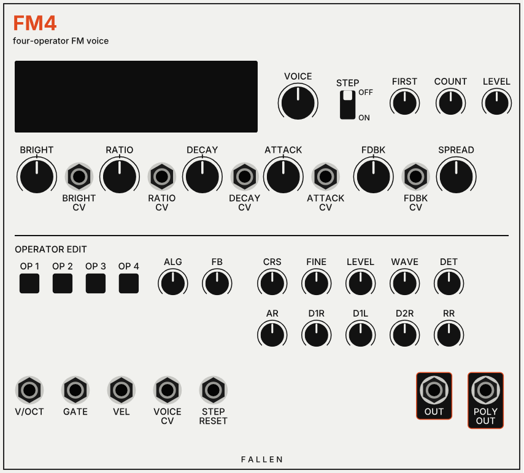
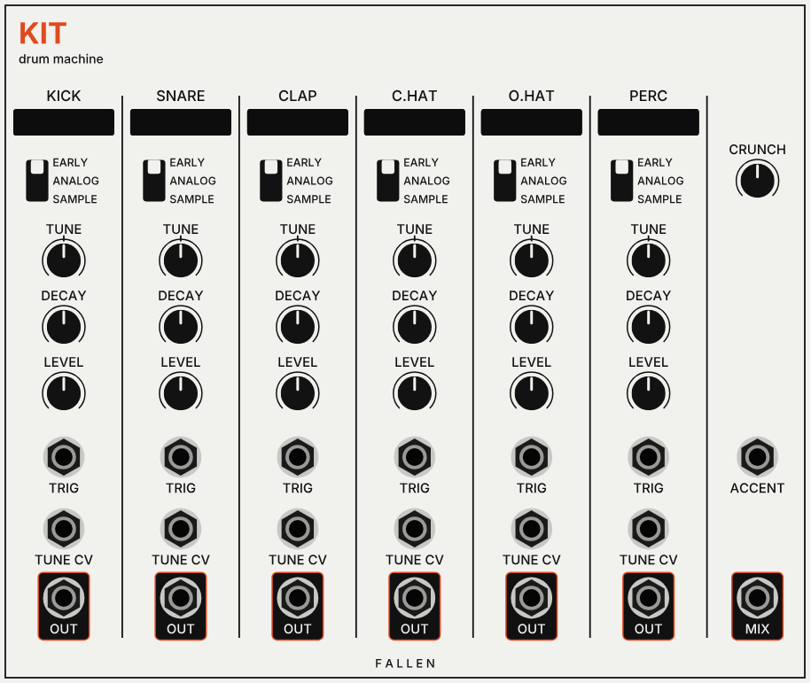
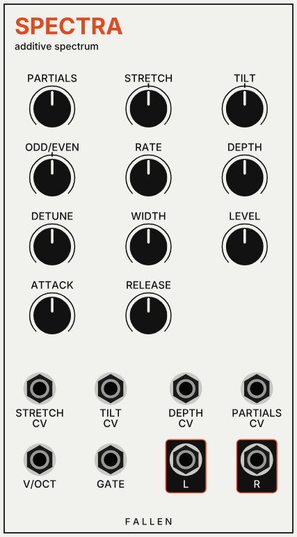

# Fallen for VCV Rack

Ten modules for making music the way Mark Fell describes making it: systems of timing that run in milliseconds rather than beats, patterns whose loops are a little too short, 4-operator FM presets "tweaked a little", and dry drum-machine sounds. You build a system, let it generate material, change one or two parameters while it runs, and record what comes out.

| Group | Modules |
|---|---|
| Time | DURA, GROUP, PRIME, HOLD |
| Patterns | LANES, CYCLE, CHORD |
| Sound | FM4, KIT, SPECTRA |

Search for any module in Rack's browser by its short name (DURA, GROUP, PRIME, HOLD, LANES, CYCLE, CHORD, FM4, KIT, SPECTRA), or by words like *milliseconds*, *SysEx*, *WAV*, *prime*, *stutter*.

## Conventions

- **Levels.** Audio is ±5 V. Pitch is 1 V/oct with 0 V = C4. Gates and triggers are 0 or 10 V, and inputs see a rise through 1 V as an edge.
- **Timing.** All timing modules count time in samples with no drift, so a pattern in milliseconds stays exact for hours and sounds the same at every sample rate.
- **Repeatable variation.** Nothing in Fallen uses a live random number. Where something varies (gate spread, fill patterns, S&H), it comes from a SEED, so the same settings always give the same result. EVOLVE options change the seed each loop, still repeatably.
- **Labels.** Two-line labels such as `STRETCH CV` mark the jack under them. Outputs sit on dark plates. Hover over any control in Rack for its full name and value.

---

## Time

### DURA: duration sequencer

Fell's sequencers are lists of durations. DURA has 16 steps, and each step is a length of time rather than a slot on a grid. The step also has a repeat count, so a step of 20 ms with REP 8 is a machine-gun stutter, and a step of 400 ms with REP 1 is a pause.

Each step's LEN knob means different things in the three MODEs, and each mode keeps its own 16 values:

- **MS**: milliseconds, 1 ms to 2 s.
- **UNITS**: whole multiples of UNIT (1 to 16). With UNIT 40 ms, a pattern of 3, 3, 2 gives 120, 120, 80 ms. Fell's interval tables are made of these.
- **RATIO**: ratios of BASE (1/4, 1/3, 1/2, 2/3, 3/4, 1, 4/3, 3/2, 2, 3, 4 and so on). Triplet and dotted steps against a fundamental.

| Control | What it does |
|---|---|
| LEN 1 to 16 | Step length, in the current MODE. The display draws each step as a bar as wide as its time. |
| REP 1 to 16 | How many times the step plays before moving on (1 to 16). |
| ON 1 to 16 | Step on, or rest (the time passes silently). |
| MODE | MS, UNITS or RATIO. |
| UNIT | Length of one unit in UNITS mode, 5 to 500 ms. |
| BASE | Length of ratio 1 in RATIO mode, 20 ms to 4 s. |
| STRETCH | Scales every step at once, ¼× to 4×. Turn this one knob while the pattern runs (the "one slider" technique). Takes effect at the next event, so it never makes a step jump. |
| STEPS | Loop length, 1 to 16. |
| NUDGE | Lengthens or shortens the last interval of the loop by up to 50%, so the loop is "a little too short" or a little too long. |
| LENGTH | Gate length, as a percentage of the time to the next event. |
| SPREAD, SEED | SPREAD varies each gate length between 1% and 99%, repeatably; SEED chooses which variation. |
| VARY | LOOP: the spread is the same every loop. EVOLVE: it differs each loop. |
| RUN, RESET | Start and stop; back to step 1. |
| CLOCK | Optional. In UNITS mode the clock period sets UNIT; in RATIO mode it sets BASE; in MS mode steps are scaled by period/100 ms. |
| Outputs | TRIG (each event on an ON step), GATE, STEP (which step), INTERVAL (time to the next event as a voltage: 0 V = 100 ms, +1 V per doubling, for HOLD), REP (the repeat number) and EOC (end of loop). |

Context menu: **Fill from table** (UNITS 1 to 10, chosen by SEED), **Reverse steps**, **Rotate right/left**, and **Wait for the first clock edge after reset**.

### GROUP: compressing and expanding bursts

Fell often plays events in small groups whose spacing tightens or relaxes inside the group, like a ball bouncing or a roll slowing down. GROUP fires a group of COUNT events. The first gap is SPACE. CURVE squeezes the later gaps (negative) or stretches them (positive). Groups start every PERIOD, or straight after the last one if the group is longer.

| Control | What it does |
|---|---|
| COUNT | Events per group, 1 to 16. |
| SPACE | First gap, 1 ms to 1 s. |
| CURVE | −1 compresses, +1 expands, 0 keeps every gap equal. |
| PERIOD | Group start to group start, 20 ms to 10 s. |
| LENGTH | Gate as a percentage of each gap. |
| FIRE, TRIG IN | Start a group now. With TRIG IN patched, groups start only on its edges. |
| DRIFT RATE, DEPTH | A slow triangle drift of SPACE from group to group (up to ±2 octaves), so successive groups differ a little. |
| CVs | COUNT, SPACE, CURVE, PERIOD. |
| Outputs | TRIG, GATE, FIRST and LAST event of the group, INDEX (position in the group), BUSY (high during a group). |

### PRIME: nested prime loops

Four Euclidean rows whose lengths are prime numbers (2, 3, 5, 7, 11, 13, 17, 19, 23, 29, 31). Prime lengths share no factors, so the rows take a long time to line up again. Set a row's source to **NEST** and it only moves when the row above it fires, which stretches the cycle further. The display shows each row and how many pulses remain until all four realign.

| Control | What it does |
|---|---|
| LEN A to D | Row length, a prime from 2 to 31. |
| HITS A to D | Events spread evenly across the row (Euclidean). |
| ROT A to D | Rotates the row. |
| SOURCE B, C, D | PULSE: the row moves on every pulse. NEST: it moves on each event of the row above. |
| RATE | Time per pulse when nothing is patched to CLOCK, 5 ms to 2 s. |
| CLOCK, RESET, RUN | External pulse, back to the start, start and stop. |
| Outputs | TRIG and GATE per row, ANY (any row fired) and REALIGN (all rows back at step 1). |

### HOLD: sustain against the gap

A stab's length is part of the rhythm. HOLD opens a gate for a percentage of the gap to the next event, so as DURA's durations change, the notes stay in proportion: short and clipped at 5%, legato at 100%, overlapping at 150%.

| Control | What it does |
|---|---|
| LENGTH | 1% to 200% of the gap. |
| ATTACK | 0.1 to 200 ms. |
| SHAPE | From a hard gate (0%) to an exponential decay that ends at the gate's end (100%). |
| TRIG | Starts a note. |
| INTERVAL | Patch DURA's INTERVAL here and HOLD knows the gap ahead of time. Without it, HOLD uses the last measured gap between triggers. |
| LENGTH CV | ±5 V = ±100%. |
| IN, OUT | A VCA (polyphonic): IN is shaped by the envelope. |
| GATE, ENV | The gate, and the envelope as 0 to 10 V. |

---

## Patterns

### LANES: drum grid with drifting loop points

A six-row grid, 32 steps wide, where every row has its own loop length and can scroll. A kick on 16 against hats on 13 and 15 gives loops "a little too short" that come back together slowly. Rows 1 to 5 are triggers, row 6 is a pitch row.

- **Click** a cell to toggle it, **drag** to paint or erase.
- On row 6, **drag a cell up or down** to set its pitch in semitones.
- The playhead shows the cell that played last on each row.

| Control | What it does |
|---|---|
| LEN 1 to 6 | Row loop length, 1 to 32. |
| SCROLL 1 to 6 | The row's pattern moves this many steps left (−) or right (+) every time it loops. |
| MUTE 1 to 6 | Mutes the row. |
| INTENSITY | Fell's relaxed-to-intense control. At 100% every set cell plays. Lower, the off-beat cells drop out first, in a fixed order, so the pattern thins out musically and always the same way. |
| PATTERN | 8 patterns. A new pattern starts at the end of row 1's loop, unless the menu says switch immediately. |
| CLOCK, RESET | Each clock edge is one step. |
| Outputs | TRIG 1 to 5, GATES (rows 1 to 5 as one polyphonic cable), PITCH and PITCH GATE (row 6). |

Context menu: clear, copy and paste the pattern, **Fill from seed**, clear a row, rename rows, and switch patterns immediately.

### CYCLE: lanes in and out of phase

Four lanes of values. Each lane has its own length and divider, and all four advance on the same trigger, so a 5-step pitch lane against a 3-step voice lane goes in and out of phase. Draw the values in the display with the mouse. The display also counts the triggers until the lanes realign.

| Control | What it does |
|---|---|
| LEN A to D | Lane length, 1 to 16. |
| DIV A to D | The lane moves every Nth trigger. |
| OFFSET A to D | Adds to the lane's output. |
| MODE A to D | UNI (0 to 10 V), BI (±5 V), PITCH (semitones as V/oct) or VOICE (0.1 V per voice, for FM4's VOICE CV). |
| TRIG, RESET | Advance every lane; back to step 1. The first trigger after reset plays step 1. |
| Outputs | OUT A to D, and POLY (all four lanes on one cable). |

Context menu: glide time per lane.

### CHORD: chord memory

Eight chord slots for house-organ stabs. The factory slots are m7, m9, m11, maj7, maj9, sus4, quartal and 7. Click the keys in the display to change the shown slot.

| Control | What it does |
|---|---|
| CHORD | Slot 1 to 8 (CHORD CV: 1 V per slot). |
| INVERT | 0 to 5: the lowest note moves up an octave, that many times (INVERT CV: 1 V per step). |
| VOICING | CLOSE, DROP2 (second-highest note down an octave) or SPREAD (every other note up an octave). |
| TRANSPOSE | ±12 semitones. |
| ROOT | V/oct root. |
| GATE IN | Copied to every output channel. Chord changes wait for its next rising edge, so a stab never changes under a held note. Unpatched, changes are immediate. |
| Outputs | V/OCT and GATE, one channel per note. Patch both into FM4. |

---

## Sound

### FM4: four-operator FM voice with SysEx loading

A 4-operator FM voice in the style of the mid-80s 4-op Yamaha synths, up to 8 voices. It **reads their voice data from `.syx` files**, so you can load banks from your own synth or from the internet, pick a preset and tweak it a little. Voices can **step on every new note**, so a sequence of five notes against three sounds goes in and out of phase.

**Playing.** Patch V/OCT and GATE (polyphonic: one channel per voice). VEL (0 to 10 V) sets velocity; unpatched, every note is full velocity. POLY OUT has one channel per voice and OUT is the mono sum.

**Choosing voices.** VOICE picks one of the 32 voices in the working bank, plus VOICE CV at 0.1 V per voice (CYCLE's VOICE mode). With **STEP ON**, every new note takes the next voice from FIRST to FIRST + COUNT − 1, wrapping, and VOICE is ignored; STEP RESET goes back to FIRST. A note keeps its voice until it ends.

**Macros** change every note without changing the stored voice. At the centre they do nothing. Each has a CV input (±5 V = full range, polyphonic).

| Macro | Effect |
|---|---|
| BRIGHT | Adds up to ±20 to every modulator's output level. |
| RATIO | Moves every modulator up or down the ratio table by up to 8 steps. |
| DECAY | ±10 rate steps on D1R and D2R. + is longer. |
| ATTACK | ±10 rate steps on AR. + is slower. |
| FDBK | ±7 on feedback. |
| SPREAD | Detunes the voices from each other, up to 20 cents. |

**Editing the voice.** The edit section writes straight into the voice VOICE shows (even while STEP is playing others). OP 1 to OP 4 choose the operator; the LED shows which. ALG (1 to 8) and FB (0 to 7) are for the whole voice; CRS (ratio), FINE, LEVEL, WAVE (W1 to W8), DET, AR, D1R, D1L, D2R and RR are for the chosen operator. When you change voice or operator the knobs jump to the stored values. Changing WAVE or FINE on a DX21-style voice makes it a TX81Z-style (extended) voice.

The display shows the voice number and name, the algorithm as text (`4>3>2>1` means 4 modulates 3, which modulates 2, which modulates 1; `+` means mixed), and the chosen operator's values, with CAR for a carrier and MOD for a modulator.

| ALG | Routing |
|---|---|
| 1 | 4 → 3 → 2 → 1 |
| 2 | (4 + 3) → 2 → 1 |
| 3 | 4 → 1 and 3 → 2 → 1 |
| 4 | 4 → 3 → 1 and 2 → 1 |
| 5 | 4 → 3, 2 → 1; out 3 + 1 |
| 6 | 4 → 3, 2, 1; out 3 + 2 + 1 |
| 7 | 4 → 3; out 3 + 2 + 1 |
| 8 | out 4 + 3 + 2 + 1 |

**Context menu.**

- **Load .syx…** reads a file and finds every SysEx message in it. A 32-voice bank replaces the working bank. A single voice replaces the voice VOICE shows.
- **Load raw 4096-byte bank…** for bank files without a SysEx header.
- **Save bank as .syx…** and **Save voice as .syx…** write files a hardware synth or another editor can read.
- **Revert voice** returns the shown voice to how it was loaded.
- **Load factory bank**.
- **Last load report** lists what the last file held: messages found and recognised, checksum status and values that were out of range and clamped.
- **Voices** sets the maximum polyphony (1 to 8). Voices are allocated by channel: channel 1 of V/OCT and GATE is voice 1, and so on.

The working bank, and the originals for Revert, are saved in the patch, so your edits are kept.

**The factory bank** (our own voices, not copies of Yamaha presets): 1 HOUSE ORG, 2 ORG HOLLOW, 3 ORG CLICK, 4 RUBBER BS, 5 PICK BASS, 6 SUB BASS, 7 SYNC BASS, 8 E.PIANO, 9 GLASS EP, 10 BELL 1, 11 BELL 2, 12 TUBULAR, 13 MARIMBA, 14 METAL PERC, 15 WOOD PERC, 16 KALIMBA, 17 PLUCK, 18 HARP, 19 BRASS STB, 20 CHORD STB, 21 VOX PAD, 22 HOLLOW PAD, 23 WARM PAD, 24 SWEEP PAD, 25 FLUTE, 26 REED, 27 NOISE HIT, 28 ZAP, 29 CLANG, 30 INHARM 1, 31 INHARM 2, 32 INIT.

### KIT: drum machine with WAV loading

Six dry drum voices: KICK, SNARE, CLAP, C.HAT, O.HAT and PERC. Each voice's switch chooses its source:

- **EARLY**: the sharp sound of early-80s sampled drum machines, synthesised and then crunched to 8-bit at about 28 kHz. CRUNCH sets how much (0 clean, 0.5 that machine, 1 harsher: 6-bit, 18 kHz).
- **ANALOG**: 808/909-style analogue synthesis: a deep ringing kick, a noisy snare, six-square-wave metallic hats.
- **SAMPLE**: a WAV file you load.

| Control | What it does |
|---|---|
| TUNE | ±24 semitones (TUNE CV: 1 V/oct). |
| DECAY | 0.1× to 2× the voice's natural decay. For samples, below 1× fades the sample out early; at 1× and above it plays in full. |
| LEVEL | Off to +6 dB. |
| TRIG | The voltage at the edge sets velocity: 10 V is full, 5 V half. |
| OUT | The voice alone. It also stays in MIX unless the menu says otherwise. |
| CRUNCH | The EARLY character, for all EARLY voices. |
| ACCENT | While high, every hit is 4 dB louder. |
| MIX | All six voices. |

C.HAT stops a ringing O.HAT, as on drum machines (menu option).

**Loading WAVs.**

- Right-click a voice's name strip and choose **Load sample…**, or drag a WAV file from your computer onto the name strip. The voice switches to SAMPLE.
- **Load kit from folder…** (module menu) picks a folder and gives each voice the first WAV whose name matches: KICK `kick, kik, bd, bassdrum`; SNARE `snare, snr, sd`; CLAP `clap, clp, cp`; C.HAT `chh, closed, hihat, hh, ch`; O.HAT `ohh, open, oh`; PERC `rim, rs, perc, cow, tom, tamb, shaker`. **Last load report** shows what went where.
- WAVs can be 8, 16, 24 or 32-bit, or 32/64-bit float, at any sample rate, mono or stereo (mixed to mono). Up to 20 s; longer files are cut. They are converted to Rack's sample rate when loaded, and again if you change it.
- The patch stores each file's path. Tick **Store samples in patch** to put the audio itself in the patch, so it works on another computer. If a file is missing when the patch opens, the strip says `MISSING: name` and the voice plays its EARLY sound until you load the file again.

Menu options: **Crunch samples** (apply CRUNCH to samples too), **Individual outs remove from mix**, **Kick drive** (ANALOG), **Snare snappy** (ANALOG, 0.3/0.6/0.9).

### SPECTRA: long linear spectrum

An additive voice of up to 32 sine partials. STRETCH pushes the partials from harmonic (0) to inharmonic and bell-like (+) or compressed (−). A soft window moves slowly up and down the partials, so the sound changes over minutes without a filter. Up to 4 voices.

| Control | What it does |
|---|---|
| PARTIALS | 1 to 32 (PARTIALS CV: 0 to 10 V). Partials above the audio range are muted. |
| STRETCH | Partial *n* sits at *n*^(1 + STRETCH/2) times the fundamental (STRETCH CV: ±5 V). |
| TILT | −12 to +6 dB per octave (TILT CV: 1 V = 3 dB/oct). |
| ODD/EVEN | −1 odd partials only, +1 even only. |
| RATE, DEPTH | The moving window's speed (0.01 to 2 Hz) and how much it shapes the sound (DEPTH CV: 0 to 10 V). |
| DETUNE | Spreads each partial by up to 20 cents, for slow beating. |
| WIDTH | Odd partials left, even partials right. |
| ATTACK, RELEASE | The envelope, driven by GATE. With GATE unpatched SPECTRA drones. |
| LEVEL | Output level. |
| V/OCT, GATE | Polyphonic, up to 4 voices. |
| L, R | Stereo out. |

---

## Patch recipes

Knob settings are starting points. Cables are written `MODULE OUTPUT → MODULE INPUT`. Every recipe ends with VCV Mix (or any mixer) and VCV Audio.

### 1. Microtime from a table

1. DURA: MODE UNITS, UNIT 40 ms, STEPS 8. Right-click, **Fill from table**. SPREAD 1, LENGTH 50%.
2. DURA TRIG → KIT TRIG 4 (C.HAT, EARLY). DURA GATE → FM4 GATE, and leave FM4 V/OCT unpatched (C4). FM4 VOICE 14 (METAL PERC).
3. Listen, then change UNIT to 50 ms: the same pattern at another table. Change SEED for another fill.

### 2. Stutters

1. DURA: MODE MS. Steps 1 to 4 at 300, 20, 180, 15 ms with REP 1, 8, 1, 12.
2. DURA TRIG → KIT TRIG 2 (SNARE) and TRIG 1 (KICK). The REP 8 and REP 12 steps are the machine-gun stutters. Turn their LEN knobs between 10 and 40 ms while it plays.

### 3. One slider

1. DURA: MODE UNITS, UNIT 50 ms, STEPS 6, LEN 3, 3, 3, 4, 2, 1.
2. DURA TRIG → KIT TRIG 1. DURA GATE → FM4 GATE (VOICE 4, RUBBER BS).
3. Perform only with STRETCH. Then patch a slow LFO (VCV LFO, 0.02 Hz) into STRETCH CV.

### 4. Bursts

1. GROUP: COUNT 5, SPACE 80 ms, CURVE −0.6, PERIOD 1.2 s, DRIFT RATE 0.05, DEPTH 0.5.
2. GROUP TRIG → KIT TRIG 5 (O.HAT). GROUP TRIG → HOLD TRIG, HOLD GATE → FM4 GATE (VOICE 1, HOUSE ORG), HOLD LENGTH 60%.
3. GROUP LAST → KIT TRIG 1 to mark the end of each burst.

### 5. Loops a little too short

1. Any clock at 8 Hz (or DURA in MS mode, one step of 125 ms) → LANES CLOCK.
2. LANES: row 1 kick on steps 1, 5, 9, 13, LEN 16. Row 3 hats every other step, LEN 13. Row 4 open hat on step 7, LEN 15. Row 2 claps on 5 and 13, LEN 15, SCROLL −1.
3. LANES TRIG 1 to 5 → KIT TRIG 1, 3, 4, 5 and 2 as you like.
4. Perform INTENSITY from relaxed (40%) to intense (100%).

### 6. Nested primes

1. PRIME: A LEN 3, B LEN 5 NEST, C LEN 7, D LEN 11. HITS 2, 2, 3, 4. RATE 110 ms.
2. Merge the four PRIME TRIG outputs into one polyphonic cable (VCV Merge) → CYCLE TRIG; or use PRIME ANY → CYCLE TRIG.
3. CYCLE lane A MODE PITCH, LEN 5; lane B MODE VOICE, LEN 4, values on voices 16, 13, 10 and 14 (KALIMBA, MARIMBA, BELL 1, METAL PERC).
4. CYCLE OUT A → FM4 V/OCT, CYCLE OUT B → FM4 VOICE CV, PRIME ANY → FM4 GATE. A nod to the metallophones on *Intra*.

### 7. Sounds against notes

1. DURA (any pattern) TRIG → CYCLE TRIG. CYCLE lane A MODE PITCH, LEN 5, draw five pitches.
2. CYCLE OUT A → FM4 V/OCT, DURA GATE → FM4 GATE.
3. FM4 STEP ON, FIRST 8, COUNT 3. Five notes against three sounds: the pairing of note and sound changes every pass and comes back after 15 notes.

### 8. Expanding the stab

1. DURA (UNITS, any pattern) TRIG → HOLD TRIG, DURA INTERVAL → HOLD INTERVAL.
2. HOLD GATE → CHORD GATE IN. CHORD slot 2 (m9), ROOT from a sequencer or a fixed voltage.
3. CHORD V/OCT → FM4 V/OCT, CHORD GATE → FM4 GATE. FM4 VOICE 1 (HOUSE ORG).
4. Sweep HOLD LENGTH from 5% to 150%: the house organ stab grows from a click to a held chord, always in proportion to DURA's durations.

### 9. Long linear spectrum

1. SPECTRA with GATE unpatched (drone). V/OCT −2 V (C2). PARTIALS 24, STRETCH 0.15, DEPTH 0.7, RATE 0.05 Hz, WIDTH 0.8, TILT −6.
2. Play recipe 1 over it. Raise STRETCH slowly to 0.5 over a few minutes.

### 10. Your own sounds

**A 4-op bank in FM4.** Banks for the DX21, DX27, DX100, TX81Z and similar 4-operator synths are shared widely online as `.syx` files (32-voice banks are 4104 bytes). Right-click FM4, **Load .syx…**. The display shows `LOADED 32 VOICES` and the file name; if it says `BAD CHECKSUM` the bank still loaded (many files online have bad checksums). **Last load report** lists the details. A DX7 bank (6-operator) is refused with a message. Pick a voice with VOICE, tweak it with BRIGHT, RATIO and DECAY, or edit an operator, then **Save bank as .syx…** to keep it.

**A kit folder in KIT.** Put WAVs in a folder with names like `kick.wav`, `snare.wav`, `clap.wav`, `hh.wav`, `oh.wav`, `rim.wav`. Right-click KIT, **Load kit from folder…**, then check **Last load report**. Drag a single WAV onto a name strip to replace one voice. Tick **Store samples in patch** before sending the patch to someone else.

### 11. Generate, record, perform

Build any of the systems above. Add VCV Recorder on the mixer output and start it. Change one or two parameters by hand for ten minutes (STRETCH, INTENSITY, HOLD LENGTH, FM4 BRIGHT), then stop. Store the settings you liked with a snapshot module such as Stoermelder 8FACE, so you can return to them. Listen back and keep the parts that work: Fell describes generating material this way and choosing from it afterwards.

---

## Using other modules with Fallen

- **Mixing**: VCV Mix or a Bogaudio mixer. Fallen has no mixer.
- **Reverb**: mostly not needed; Fell's own work is dry. Valley Plateau if you want space.
- **Recording and snapshots**: VCV Recorder; Stoermelder 8FACE or TRANSIT.
- **Tempo clock**: any clock module (e.g. Impromptu Clocked) into DURA CLOCK when DURA should follow a BPM.
- **Other FM**: Valley Dexter is a fine FM voice but does not load 4-op banks or step through voices per note, which is why FM4 exists.

## The SysEx formats FM4 reads

| Message | Header | Size | What FM4 does |
|---|---|---|---|
| 32-voice bulk (VMEM) | `F0 43 0n 04 20 00` | 4096 bytes | Replaces the working bank |
| Single voice (VCED) | `F0 43 0n 03 00 5D` | 93 bytes | Replaces the shown voice |
| Additional voice data (ACED, TX81Z) | `F0 43 0n 7E 00 21` + `LM  8976AE` | 23 bytes | Adds waveforms, fixed frequency and fine ratio to the single voice with it |
| Performance, system, microtuning | | | Ignored, listed in the report |
| 6-operator bank (DX7) | `F0 43 0n 09 20 00` | | Refused with a message |

The device channel `n` is ignored. TX81Z banks keep their extra data in bytes 73 to 83 of each packed voice; when those are all zero the voice is treated as a DX21-style voice (sine waves, ratio mode).

## Where the ideas come from

Mark Fell has described his working methods in interviews, papers and talks: sequencers built in Max from lists of millisecond durations and repeat counts; interval tables of whole multiples of 40 or 50 ms; groups of events compressed or expanded; one parameter stretching a whole pattern; patterns layered with loops one step short and scrolling in different directions; a relaxed-to-intense density control; nested prime-number loops; 4-op FM presets from Yamaha synths tweaked a little and stepped through note by note; early-90s house organ stabs whose length changes; and dry drum-machine sounds. *Multistability* has long linear-spectrum textures under its percussion. The research notes, with sources, are in `RESEARCH-AND-PROPOSAL.md` in the plugin's repository.

Fallen is an independent project, not affiliated with Mark Fell or with Yamaha, Roland or any other maker. Names belong to their owners.
